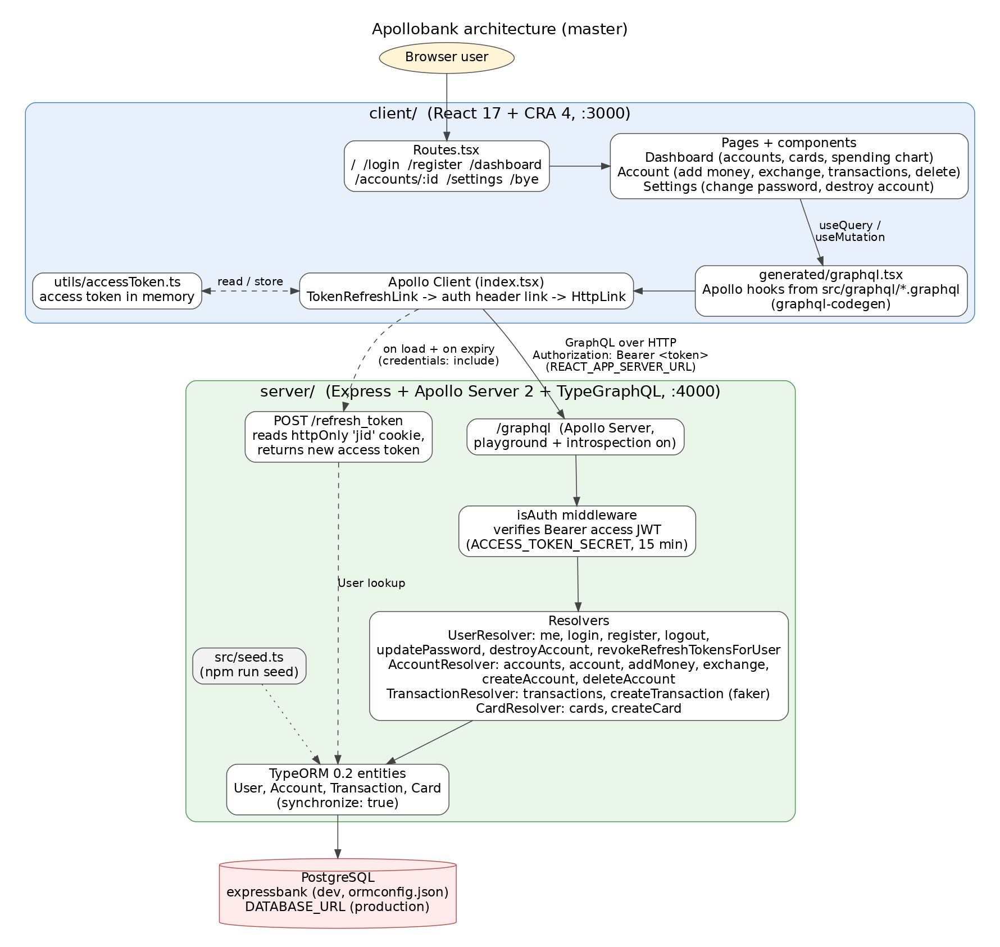

# Apollobank architecture

This page describes what the code on `master` does today. The diagram source is [`diagrams/architecture.dot`](diagrams/architecture.dot) (Graphviz); run [`diagrams/render.sh`](diagrams/render.sh) after editing it to regenerate the PNG and SVG.

## Overview

Apollobank is a two-process app:

| Part | Path | Stack | Port |
|---|---|---|---|
| Client | `client/` | React 17, Create React App 4 (`react-scripts`), Apollo Client 3, Material UI 4, Formik + Yup, Recharts | 3000 |
| Server | `server/` | Express 4, Apollo Server 2 (`apollo-server-express`), TypeGraphQL 1, TypeORM 0.2, `@hapi/joi`, `jsonwebtoken`, `bcryptjs` | 4000 |
| Database | — | PostgreSQL (`expressbank` locally) | 5432 |

The root `package.json` only runs the two together (`concurrently`); it has no app code.

## Client (`client/src`)

- **Entry (`index.tsx`)** builds an Apollo Client with three links, in order: `TokenRefreshLink` (when the in-memory access token has expired, it `POST`s `/refresh_token` and stores the new token), a request link that adds `Authorization: Bearer <token>`, and an `HttpLink` to `${REACT_APP_SERVER_URL}/graphql` with `credentials: 'include'`.
- **`App.tsx`** calls `/refresh_token` once on load, so a returning user with a valid `jid` cookie is signed in again, then renders the routes.
- **Access token (`utils/accessToken.ts`)** is a module-level variable. It is never written to `localStorage`, so a page reload always goes through `/refresh_token`.
- **Routes (`Routes.tsx`)**: `/` (Home), `/login` and `/register` (redirect to `/dashboard` when signed in), `/dashboard`, `/accounts/:id` and `/settings` (redirect to `/login` when signed out), `/bye` (after account deletion), and a 404 fallback.
- **Pages**
  - *Dashboard*: lists currency accounts and cards (`accounts`, `cards`, `createAccount`, `createCard`), shows a total balance converted to GBP with rates hard-coded in the page, and a "spending this month" chart (`components/Charts/Chart.tsx`, `transactions` query).
  - *Account*: one currency account; add money, exchange to another of the user's accounts, generate a random transaction, view transactions, delete the account (`account`, `addMoney`, `exchange`, `createTransaction`, `transactions`, `deleteAccount`).
  - *Settings*: profile details (`me`), change password (`updatePassword`), delete the user (`destroyAccount`) and log out.
- **GraphQL documents** live in `src/graphql/*.graphql`. `npm run gen` (graphql-codegen, `codegen.yml`) reads the running server's schema at `http://localhost:4000/graphql` and writes typed hooks to `src/generated/graphql.tsx`.
- **Environment**: `.env.development` points `REACT_APP_SERVER_URL` at `http://localhost:4000`; `.env.production` points it at `https://apollo-bank.herokuapp.com`.

## Server (`server/src`)

- **Entry (`index.ts`)** creates an Express app with `cookie-parser` and CORS (`http://localhost:3000`, or a Netlify URL when `NODE_ENV=production`, with credentials), then:
  - `GET /` returns a health string.
  - `POST /refresh_token` verifies the `jid` cookie with `REFRESH_TOKEN_SECRET`, loads the user, sets a fresh `jid` cookie and returns `{ ok, accessToken }`.
  - Connects TypeORM (`createConnection()` from `ormconfig.json` in development, `utils/createTypeOrmConnection.ts` with `DATABASE_URL` in production).
  - Mounts Apollo Server at `/graphql` with a schema built by TypeGraphQL from the four resolvers. Introspection and the playground are on. The GraphQL context is `{ req, res }`.
  - Listens on `PORT` or 4000.
- **Auth (`utils/auth.ts`, `middleware.ts`, `utils/sendRefreshToken.ts`)**: `login` checks the bcrypt hash, returns a 15-minute access JWT (`{ userId }`) and sets a 7-day refresh JWT (`{ userId, tokenVersion }`) in the httpOnly `jid` cookie, scoped to path `/refresh_token`. The `isAuth` TypeGraphQL middleware verifies the Bearer token on protected resolvers and puts the payload on the context.
- **Validation (`utils/validation.ts`)**: Joi schemas for `register`, `login` and `updatePassword`.
- **Resolvers**

  | Resolver | Queries | Mutations |
  |---|---|---|
  | `UserResolver` | `me` | `login`, `register`, `logout`, `updatePassword`*, `destroyAccount`*, `revokeRefreshTokensForUser` |
  | `AccountResolver` | `accounts`*, `account(currency)`* | `addMoney`*, `exchange`*, `createAccount`*, `deleteAccount`* |
  | `TransactionResolver` | `transactions(currency)`* | `createTransaction`* |
  | `CardResolver` | `cards`* | `createCard`* |

  \* guarded by `isAuth`.

  Accounts are looked up by owner and currency (EUR, USD or GBP), so a user has at most one account per currency. New accounts get a random sort code, IBAN and BIC and a 1000 balance. `exchange` uses hard-coded conversion rates. `createTransaction` generates a random transaction with `faker` and adjusts the balance. `createCard` creates a card with a random number, PIN and CVV and a fixed expiry (October 2023). The `cards` query looks cards up by `account`, but `Card` only relates to `User` (`owner`), so on `master` it fails with `No entity column "account" was found` and the dashboard gets no cards.
- **Entities (`entity/`)**: `User` 1—* `Account` 1—* `Transaction`, and `User` 1—* `Card` 1—* `Transaction`. Tables are `users`, `accounts`, `transactions`, `cards`; `synchronize: true` creates and alters them on start, and there are no migrations.
- **Seed (`seed.ts`, `npm run seed`)**: truncates all four tables, then creates `demo@apollobank.com` plus five random users, each with 2 accounts, 2 cards and 10 transactions per account (password `password123` for all).

## Configuration

| Setting | Where | Used for |
|---|---|---|
| `ACCESS_TOKEN_SECRET`, `REFRESH_TOKEN_SECRET` | `server/.env` (loaded by `dotenv`) | Signing and verifying JWTs; required |
| Postgres host, user, database | `server/ormconfig.json` (`default` connection) | Local database |
| `NODE_ENV=production`, `DATABASE_URL`, `PORT` | Server environment | Production DB connection, CORS origin, port |
| `REACT_APP_SERVER_URL` | `client/.env.development`, `client/.env.production` | Server base URL for GraphQL and `/refresh_token` |

## Deployment artifacts in the repo

- `server/Procfile` (`web: node dist/index.js`) is a Heroku process file. The committed `server/dist/` is an old build (it has only the User and Account resolvers), so run `npm run build` in `server/` before using it.
- `client/build/` is a committed production build, and `client/public/_redirects` is a Netlify SPA rewrite.

## Tooling and tests

- Node 16 runs both halves with the committed lockfiles (Node 14 also works for the client). On Node 18+ the client's `react-scripts@4` fails with `ERR_PACKAGE_PATH_NOT_EXPORTED` from `postcss-safe-parser`. See [`SETUP.md`](../SETUP.md).
- `client/src/generated/graphql.tsx` imports `@apollo/react-common`, which is not installed, so the client only compiles with `TSC_COMPILE_ON_ERROR=true`.
- `master` has no test files. The client's `npm test` runs `react-scripts test` (Jest and Testing Library are installed); `server/package.json` has no `test` script.
